# Automatic Slot Reel Tuning by Simulation: Genetic Algorithm vs Local Search

**Can a computer design the reel strips of a slot game so that the game pays back exactly
what the designer intends — and which kind of search method should it use?**

This project contains a fast C++ slot-game simulator, a Python optimizer that uses it to tune
reel strips automatically, and a controlled experiment (30 independent seeds, 2,700+
optimization runs, 2.7 million simulator calls, about 83 hours of computing) comparing nine
genetic-algorithm (GA) designs with three simpler search methods.

### How the project developed

The project **started as a genetic-algorithm project**: the plan was to show that a GA can tune
reel strips and to find the best GA design. To test that claim fairly, simple baseline methods
were added that start from the same reels, use the same mutation and get the same computing
budget. The 30-seed experiment then showed something more useful than "the GA works": **the
well-configured GA and simple local search (hill climbing, simulated annealing) end in a
statistical draw.** Both are good enough for the job; what decides success is choosing the
right *settings*, not choosing a GA over local search. This README reports that finding as it
came out.

> **Findings in brief**
>
> 1. **Automatic tuning works.** From random reels (median error about 80), every sensible
>    method reaches the three base-game targets within a few percent in 1000 simulations
>    (≈ 2.5 minutes of computing). Random search, with the same budget, never gets close (37.5).
> 2. **GA and local search are tied when each is set up properly.** At their best settings the
>    best GA and simulated annealing differ by 0.001 in median error on the base game (0.076 vs
>    0.075) and win about half of the seed-by-seed matches each. No well-configured GA is
>    significantly better than simulated annealing, and simulated annealing is not
>    significantly better than it, in any experiment.
> 3. **Settings matter more than the method family.** A GA with plain *Generational*
>    replacement is significantly worse than everything else except random search; heavy
>    mutation (10 of 250 positions) hurts almost every method. Proper settings for both
>    families are given in [section 7](#7-conclusions).
> 4. **Simulator noise was measured and does not drive these conclusions**; it only blurs the
>    order among the top methods, which is why they are reported as tied.
> 5. **The free-game targets conflict with each other** under this game's rules, so no method
>    reaches them; all methods face the same conflict and the comparison still holds.

---

## Contents

1. [Setting up](#1-setting-up)
2. [Project structure](#2-project-structure)
3. [What we are trying to achieve](#3-what-we-are-trying-to-achieve)
4. [How the optimizers work](#4-how-the-optimizers-work)
5. [How the experiment was performed](#5-how-the-experiment-was-performed)
6. [Results](#6-results)
   - [6.1 Everything at a glance](#61-everything-at-a-glance)
   - [6.2 Base game](#62-base-game)
   - [6.3 Free game](#63-free-game)
   - [6.4 How much does simulator noise matter?](#64-how-much-does-simulator-noise-matter)
   - [6.5 Statistical summary](#65-statistical-summary)
   - [6.6 Computing cost](#66-computing-cost)
7. [Conclusions](#7-conclusions)
8. [Limitations and what could be improved](#8-limitations-and-what-could-be-improved)
9. [Glossary](#9-glossary)

---

## 1. Setting up

Everything about installing and running is in **[RUNNING.md](RUNNING.md)**. In short:

| Step | Linux / macOS | Windows |
|---|---|---|
| 1. Get the simulator — **download** it from *Releases* (no C++ needed) **or build** it with CMake | `build/simulator` | `build\simulator.exe` |
| 2. Python environment | `python3 -m venv .venv && source .venv/bin/activate` | `python -m venv .venv; .venv\Scripts\Activate.ps1` |
| 3. Packages | `pip install -r Requirements.txt` | same |
| 4. Point `GA-config.yaml → paths.simulatorPath` at the simulator, then a quick test | `python Optimizer/main.py quick-test.yaml` | same |

RUNNING.md has step-by-step instructions for Ubuntu/Debian, Fedora, Arch, macOS and
Windows, explains every important script (optimizer, parallel runner, AWS spot setup,
statistics, noise study, charts) and lists the exact order that reproduces every number and
chart below.

---

## 2. Project structure

```
Slot-Math-Optimization-GA/
├── README.md                     this document: goal, method, results, conclusions
├── RUNNING.md                    install and run guide (every OS, every script)
├── GA-config.yaml                every setting of the study (targets, budget, methods, paths)
├── Requirements.txt              Python packages (PyYAML, numpy, pandas, matplotlib, scipy)
├── Setup_spot.sh                 prepares a fresh AWS Ubuntu instance (tools, build, venv, S3)
├── Spot_watch.sh                 watches for AWS spot interruption and saves results to S3
│
├── Simulator/                    C++20 slot-game simulator (the "fitness function")
│   ├── CMakeLists.txt            build script (always build Release)
│   └── src/
│       ├── main.cpp              command line: spins, reelset, mode, output file, seed
│       ├── constants.hpp         the game: 5x3 window, 20 paylines, 9 symbols, paytable, 10 free spins
│       ├── reelsFunction.hpp     reads a reelset file, draws the visible symbols for a spin
│       ├── WinningFunctions.hpp  evaluates line wins, wilds, scatters, free-game triggers
│       ├── reelset.json          default reelset used when none is given
│       ├── multiThread/
│       │   └── SimRunner.hpp     splits spins into 1M-spin jobs over threads, seeded per job
│       ├── Stats/                statistics gathered while spinning
│       │   ├── simResult.hpp         RTP, hit rate, trigger/retrigger rates → JSON output
│       │   ├── baseMatrixData.hpp    base-game counters
│       │   ├── freeMatrixData.hpp    free-game counters
│       │   ├── buyFreematrixData.hpp "buy free spins" counters
│       │   ├── reelMatrixData.hpp    per-reel counters
│       │   └── symbolsData.hpp       per-symbol win counts (the console table)
│       └── Utility/
│           ├── Rng.hpp           seeded random number generator (reproducible spins)
│           ├── MiniJson.hpp      writes the JSON result file
│           └── Utilities.hpp     small helpers
│
├── Optimizer/                    Python optimizer and analysis
│   ├── main.py                   entry point: runs every GA combination and baseline per seed
│   ├── run_parallel.py           runs many seeds at once; resume, S3 upload, merge
│   ├── prepare_fixedBase.py      sets up the fixed-base free-game check (section 5.4)
│   ├── Parents.py                a "parent" = one complete reelset + its statistics and fitness
│   ├── FitnessFunction.py        writes a reelset, calls the simulator, scores the output
│   ├── Selection.py              Tournament, Roulette, SUS; crossover; mutation
│   ├── Replacement.py            Steady-state, Generational, Elitist generational
│   ├── Baselines.py              Random search, Hill climbing, Simulated annealing
│   ├── Utility/
│   │   ├── Config.py             reads and validates GA-config.yaml (clear one-line errors)
│   │   ├── Seeding.py            derives every random seed from the run number (reproducibility)
│   │   ├── Helpers.py            seeds, result keys, starting parents, free-game plumbing, final check
│   │   └── Utility.py            simulator calls, reelset files, initial population
│   ├── Stats/
│   │   ├── Stats.py              Friedman + Wilcoxon/Holm + A12 tests between methods
│   │   ├── MutationsStats.py     the same tests between mutation counts
│   │   ├── NoiseStudy.py         re-simulates best reelsets 30x to measure simulator noise
│   │   ├── Compute.py            records the time of every simulator call and the machine
│   │   ├── Compare.py            draws charts 1–14 and compute_report.md
│   │   └── ExtraGraphs.py        draws charts 15–17 (noise, head-to-head, overview)
│   └── ReelSets/                 working reelset files (InitialParents/, TempParents/, fixed_base.json)
│
├── Results/                      (results.json is kept in S3/Zenodo, not in git)
│   ├── Graphs/                   all charts in this README (+ FreeGame/), compute_report.md
│   └── stats/                    test reports and CSVs: base, FreeGame/, FreeGame_fixedbase/,
│                                 mutation_base/, mutation_free/, mutation_free_fixedbase/
├── NoiseStudy/                   report.txt, noise_runs.csv, noise_summary.csv, reelsets/
├── Parallel/                     one folder per run while run_parallel.py works (log, config, results)
└── build/                        created when you build or download the simulator
```

---

## 3. What we are trying to achieve

### The problem, in plain words

A video slot shows a window of symbols (here 5 columns × 3 rows). Each column is cut from a
long **reel strip** — a fixed list of symbols (here 50 per reel). When you spin, each reel stops
at a random position; you win if matching symbols line up on one of the 20 paylines. Three or
more *scatter* symbols trigger a round of 10 **free spins**, played on a second, separate set of
reels.

> **Game rule note: six or more scatters.** The paytable has scatter prizes for 3, 4 and 5
> scatters. A 5×3 window can show more than five, and the simulator handles that as follows:
>
> - **Base game:** 6+ scatters pay no scatter prize and do not trigger free spins.
> - **Free game:** 6+ scatters pay no scatter prize but still retrigger 10 more free spins.
>
> **How often it matters.** On the two tuned base reelsets checked, 6+ scatters cannot occur at
> all. On a tuned free reelset (Steady-state + Roulette, mutation 3) the exact chance is about
> 1 in 965,000 free spins (one occurrence in about 1.55 million free spins in a 10M-spin run).
> Even if those spins paid the 5-scatter prize (500× bet), free RTP would change by about
> 0.00008, roughly 20 times smaller than the simulation noise of free RTP (SD ≈ 0.0015).
> Random starting reels contain more scatters, so the case is more common early in a run,
> but every method is scored by the same simulator, so it cannot favour one method over another.
>
> **Code history.** An earlier version of the free game looked up a prize for 6+ scatters
> beyond the end of the paytable (undefined behaviour in C++). The Linux builds used for this
> study read 0 there, which is the rule above; another compiler could read a tiny non-zero
> value. The current code pays 0 explicitly. Recorded noise-study runs (a base-game and a
> full-game run) were reproduced bit for bit with the fixed simulator, on both Linux and
> Windows, so **all results in this README are unchanged**. Whether 6+ scatters *should* pay a prize is a game-design choice; changing it
> would change future results, not these.

Everything a player experiences — how much the game pays back on average, how often a spin
wins, how often the bonus round comes — is decided by **which symbols sit where on the
reel strips**. Mathematicians in the industry design these strips by hand: change a few
symbols, simulate millions of spins, check the numbers, repeat. With 9 symbols and 250
positions per reel set, the number of possible strips is astronomically large (9²⁵⁰), and
the numbers can only be measured by simulation, not calculated from a formula.

The targets used in this study:

| Game part | Statistic | Target | Meaning | Weight |
|---|---|---|---|---|
| Base game | RTP (return to player) | 0.57 | the base game pays back 57% of all bets on average | 10 |
| | Hit rate | 3 | one spin in 3 wins something | 6 |
| | Free-game trigger rate | 80 | the bonus round starts once every 80 spins | 3 |
| Free game | Free RTP | 0.38 | the bonus round adds another 38% of bets (total ≈ 95%) | 10 |
| | Free hit rate | 2.7 | one free spin in 2.7 wins | 6 |
| | Retrigger rate | 60 | a free spin awards more free spins once in 60 | 3 |

### The questions this experiment answers

The project began with the aim of building a genetic algorithm for this task. As the work
went on, the questions widened from "does the GA work?" to "which method should a slot
mathematician actually use?". The experiment was designed to answer four questions:

| | Question | Why it matters |
|---|---|---|
| **Q1** | Can reel strips be tuned automatically to several targets at once, using only simulation? | If not, nothing else matters. |
| **Q2** | Which GA design choices matter — *replacement*, *selection*, *mutation strength*? | A GA has many settings; a designer needs to know which ones to get right. |
| **Q3** | Is a GA better than simpler local search, given the same start and the same computing? | A complex method is only worth it if it beats a simple one under fair conditions. |
| **Q4** | How much could the simulator's own randomness (noise) distort the answers? | Every score comes from a finite simulation; small differences might be luck. |

The answers are summarised at the top of this page and argued in detail in
[section 7](#7-conclusions).

---

## 4. How the optimizers work

### Scoring a reelset (the fitness)

The simulator plays a reelset for 10 million spins and reports each statistic *x*. Each goal
has a target *t* and a weight *w*. The score is the weighted sum of relative errors:

$$F = \sum_i w_i \cdot \frac{|x_i - t_i|}{t_i}$$

**Lower is better; 0 means every target is hit exactly.** Relative errors let goals of very
different size (an RTP of 0.57 and a trigger rate of 80) sit side by side. As a feel for the
scale: an error of 0.1 in the base game means, for example, an RTP of 0.5757 instead of 0.57
(1% off, weight 10) with everything else exact.

### The genetic algorithm

A population of 10 complete reelsets evolves:

```
start: 10 random reelsets, simulate and score each
repeat until 1000 evaluations are used:
    pick parents                    (selection)
    combine and tweak them          (crossover + mutation)
    simulate and score the children
    decide who stays                (replacement)
keep the best reelset ever seen
```

| Choice | Options compared |
|---|---|
| **Selection** — who becomes a parent | **Tournament**: draw 3 at random, keep the best. **Roulette**: a wheel where better reelsets get bigger slices (sized by rank). **SUS**: the same wheel spun once with evenly spaced pointers — less luck than roulette. |
| **Crossover** — mixing two parents | For each reel, a random cut point; the child takes parent 1's strip before it and parent 2's after it. |
| **Mutation** — tweaking a child | Change *m* random positions (out of all 250) to a different symbol. *m* ∈ {1, 3, 5, 10}. |
| **Replacement** — who survives | **Steady-state**: one child per step; it replaces the worst reelset if better. **Generational**: 10 children replace the whole population. **Elitist generational**: the 2 best survive, 8 children fill the rest. |

3 replacement strategies × 3 selection methods = **9 GA configurations**, each run at 4
mutation counts.

### The comparison methods (local search and random search)

| Method | How it works |
|---|---|
| **Random search** | A brand-new random reelset every evaluation; keep the best. Shows how hard the problem is. |
| **Hill climbing** (a "(1+1) evolutionary algorithm") | One reelset; mutate it with the *same* mutation operator; keep the child if it is at least as good. |
| **Simulated annealing** | Like hill climbing, but sometimes accepts a worse child, less and less often as the run goes on (temperature 0.14 → 0.002). |

Hill climbing and simulated annealing were added as **fair, strong comparisons**: they use the
GA's own mutation operator, start from the best of the GA's starting reelsets, and get the same
1000-evaluation budget. Random search only shows how hard the problem is. In the tables and
charts these three are labelled "baselines".

---

## 5. How the experiment was performed

### 5.1 Design

| Setting | Value |
|---|---|
| Seeds (independent repetitions) | **30** (run numbers 1–30) |
| Stages per seed | base game, then free game (`gameMode: Both`) |
| GA configurations | 9 (3 replacement × 3 selection) |
| Mutation counts | 1, 3, 5, 10 positions out of 250 |
| Baselines | Random search, Hill climbing, Simulated annealing |
| Population size | 10 |
| Budget per run | **1000 fitness evaluations** (equal for every method) |
| Spins per evaluation | 10,000,000 |
| Final check of each run's best reelset | 100,000,000 spins on a seed the run never used |
| Runs | 1,350 per stage (+ 990 in the fixed-base check) |
| Hardware | AWS c7a.16xlarge (AMD EPYC 9R14, 64 cores), 6 runs × 10 threads in parallel |

Because the replacement strategies make different numbers of children per step, they are
compared at an equal **number of evaluations**, not generations: 1000 steps for Steady-state,
125 generations for Elitist, 100 for Generational.

### 5.2 Fair comparison: the same seed means the same starting point

For each seed, **every method starts from the same 10 random reelsets**, uses the **same
simulator seed** for every evaluation, the **same mutation operator and count**, and the **same
budget**. So "seed 7, mutation 5" is a head-to-head match between all twelve methods under
identical conditions, and the statistics compare methods **seed by seed** (paired tests).
Every random number is derived from the run number, so any run can be reproduced exactly.

### 5.3 Dealing with noise

Every score comes from a finite number of simulated spins, so it has random error. Three
safeguards:

1. **Independent final check.** The best reelset of every run is re-simulated with 10× more
   spins on an unused seed. All reported final errors are these re-checked values, because the
   in-run best is the *luckiest* of 1000 noisy scores and is biased low (section 6.4).
2. **Noise study.** The best reelset of each method, for each stage and mutation count (96
   reelsets), was re-simulated 30 times on different seeds: 2,880 extra simulations measuring
   exactly how much each statistic and the fitness wobble.
3. **Noise floor.** Any difference smaller than the measured noise floor is reported as
   "within noise", whatever its p-value.

### 5.4 The free game, and the fixed-base check

In the free stage only the free-game reels evolve; the base reels are held fixed (they set how
often the bonus starts). In `Both` mode each method's free stage uses the base reels **that
same method** found, which means base-game luck could leak into the free-game comparison. To
rule that out, the free stage was run a second time (**fixed-base check**, 990 runs, mutation
3/5/10) with **one** base reelset — the best one found overall — for every method and seed.

### 5.5 Statistics

- **Friedman test** — do the methods differ at all (per mutation count)?
- **Wilcoxon signed-rank test, paired by seed**, with **Holm correction** for running many
  comparisons — which pairs differ? (α = 0.05)
- **Vargha–Delaney A12** effect size — the chance that method A ends lower than method B on a
  run (0.5 = no difference; ≥0.71 is "large").
- A result counts as a finding only if it is **significant after Holm, at least a small effect,
  and larger than the noise floor**.

---

## 6. Results

All final errors are the 100M-spin re-checks, as medians over 30 seeds. Lower is better.

### 6.1 Everything at a glance

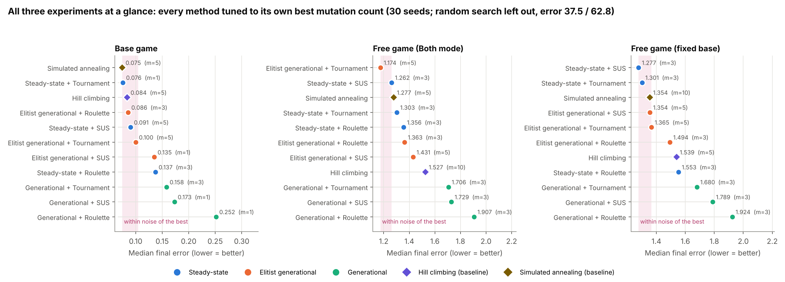

Each method is shown at its own best mutation count, in the base game, the free game, and the
fixed-base free-game check. The shaded band is the noise floor next to the best result: points
inside it cannot be told apart from the winner. Three patterns repeat in every panel:
**plain Generational (green) is at the bottom**; Steady-state (blue), Elitist (orange) and the two
local-search methods (diamonds) **crowd together at the top**; random search (not shown, error
37.5 and 62.8) is hopeless.

#### The main comparison: best GA vs local search, head to head

Each comparison below is paired by seed: both methods started from the same reelsets, with the
same simulator seed and budget. "Lower on" counts the seeds where the first method ended with
the lower error; p is the Holm-corrected Wilcoxon test; A12 = 0.5 means no difference.

| Experiment | Best GA (setting) | vs Simulated annealing | vs Hill climbing | Verdict |
|---|---|---|---|---|
| Base game, each method at its best mutation count | Steady-state + Tournament (m=1): **0.076** | SA (m=5) **0.075**; SA lower on 15/30; A12 0.53; p = 1.0 | HC (m=5) 0.084; HC lower on 12/30; A12 0.50; p = 1.0 | **Draw** |
| Free game, mutation 5 | Elitist + Tournament: **1.174** | SA 1.277; GA lower on 19/30; A12 0.54; p = 1.0 | HC 1.559; GA lower on 16/30; A12 0.58; p = 1.0 | **Draw** |
| Free game, mutation 3 | Steady-state + SUS: **1.262** | SA 1.532; GA lower on 22/30; A12 0.66; p = 0.72 | HC 1.780; GA lower on 27/30; A12 0.83; **p < 0.001** | GA beats HC; **draw with SA** |
| Free game, fixed base, mutation 3 | Steady-state + SUS: **1.277** | SA 1.571; GA lower on 18/30; A12 0.56; p = 1.0 | HC 1.750; GA lower on 26/30; A12 0.76; **p < 0.001** | GA beats HC; **draw with SA** |

Across every experiment, **no properly configured GA and simulated annealing can be told
apart**. The GA's only significant advantage is over hill climbing in the free game at mutation 3.

### 6.2 Base game

#### Every configuration and mutation count

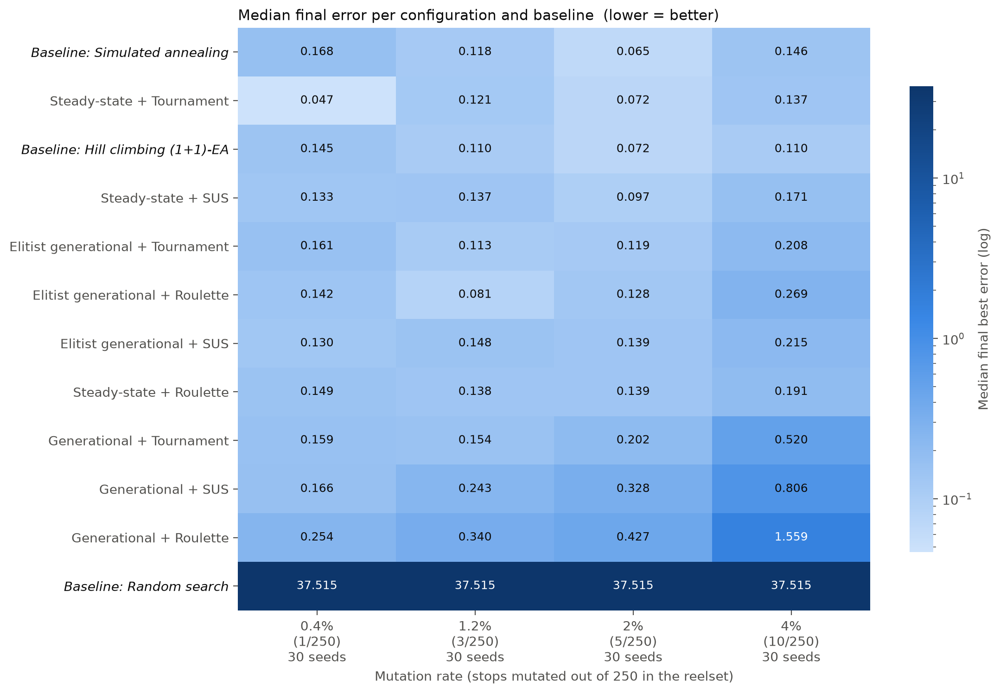

| Method (all 4 mutation counts, 120 runs) | Median | Middle 50% of runs |
|---|---|---|
| Steady-state + Tournament | **0.119** | 0.050 – 0.181 |
| Hill climbing (baseline) | 0.127 | 0.050 – 0.191 |
| Simulated annealing (baseline) | 0.145 | 0.057 – 0.192 |
| Steady-state + SUS | 0.147 | 0.067 – 0.198 |
| Steady-state + Roulette | 0.154 | 0.088 – 0.224 |
| Elitist + Roulette | 0.155 | 0.067 – 0.244 |
| Elitist + Tournament | 0.158 | 0.080 – 0.234 |
| Elitist + SUS | 0.159 | 0.081 – 0.222 |
| Generational + Tournament | 0.209 | 0.146 – 0.341 |
| Generational + SUS | 0.305 | 0.186 – 0.479 |
| Generational + Roulette | 0.440 | 0.251 – 0.776 |
| Random search (baseline) | 37.5 | — |

Every method except random search starts from a median error of about 80 and ends around 0.1: the
base-game targets are reached to within a few percent on almost every seed.

#### Replacement strategy decides the result

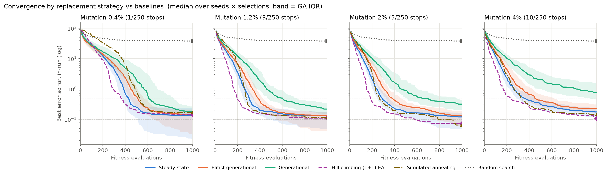

- **Generational** replacement (green) is slowest at every mutation count and falls apart as
  mutation grows (median 0.18 → 0.75 from 1 to 10 changed positions). It throws away the whole
  population every generation, so a good reelset survives only if a child happens to copy it.
  It loses to Steady-state and to Elitist in every significant comparison
  (e.g. mutation 5: 28/30 and 26/30 seeds, A12 = 0.96 and 0.94).
- **Steady-state** (blue) and **Elitist** (orange) are **statistically tied** at mutation 1, 3
  and 5. Only at mutation 10 does Steady-state pull ahead (0.162 vs 0.224, p = 0.007).
- **Hill climbing** (dashed purple) drops fastest early on; Steady-state, Elitist and simulated
  annealing close most of that gap by about 400 evaluations.

#### How fast a good answer appears

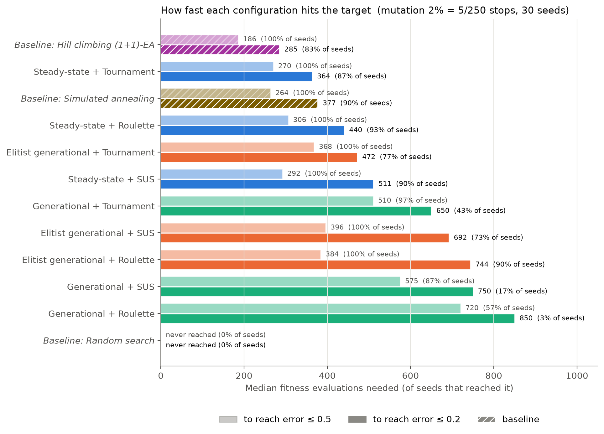

At mutation 5, hill climbing needed a median of 285 evaluations to reach error 0.2 (on 83% of
seeds); Steady-state + Tournament 364 (87%); simulated annealing 377 (90%). Plain Generational +
Roulette reached 0.2 on only 1 of 30 seeds.

#### Mutation: gentle is better

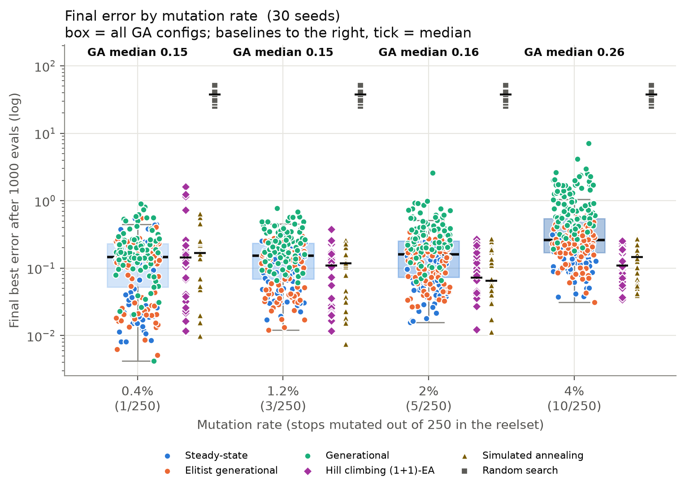

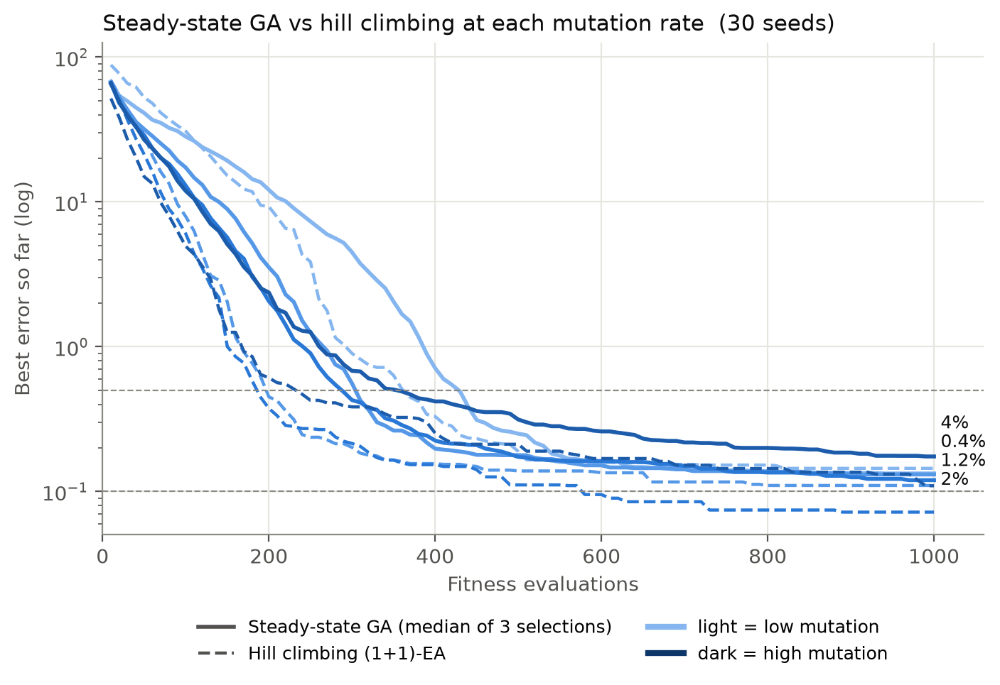

Changing 3–5 of 250 positions per child (about one symbol per reel) is the sweet spot for most
methods. Ten changes per child is significantly worse than a gentler setting for 9 of the 11 methods; the damage is
largest for Generational (Generational + Roulette: 0.25 at m=1 → 1.55 at m=10). The best count
per method was m=5 for simulated annealing, hill climbing, Steady-state + SUS and Elitist +
Tournament; m=3 or m=1 for the rest.

#### Selection matters only when replacement is weak

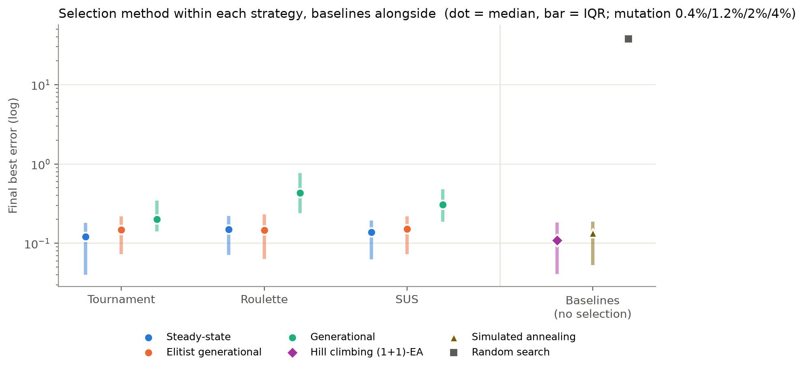

Within Steady-state and within Elitist, **no selection method is significantly better than
another** at any mutation count (Friedman p ≥ 0.026 and no pair survives Holm correction).
Within plain Generational, selection is the only force pushing the population forward, and
**Tournament is significantly better than Roulette at every mutation count** (A12 0.72–0.88).

#### Diversity: why Steady-state is fast and Elitist is robust

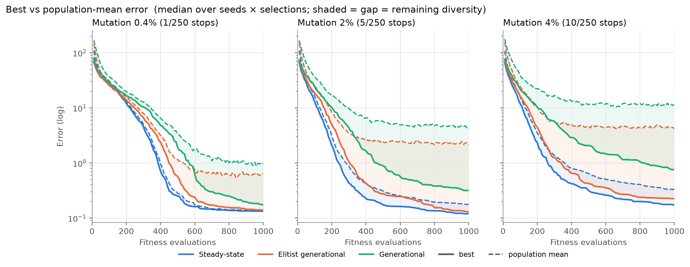

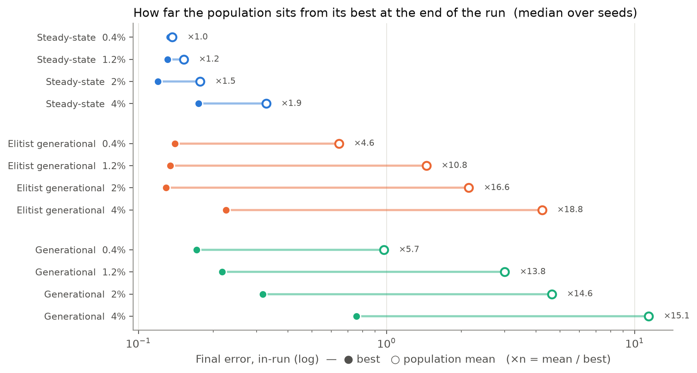

The gap between the best reelset and the population average shows how varied the population
still is. **Steady-state** collapses to near-copies of its best reelset (average ≈ best), which
makes it converge quickly but leaves little to recombine. **Elitist** keeps a much more varied
population while its two elites protect the best reelset. **Generational** stays varied but
keeps losing its best.

#### GA vs local search over all settings

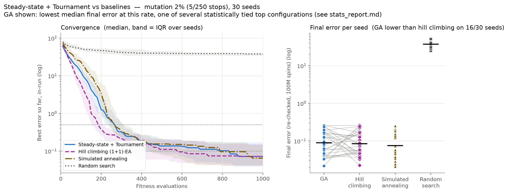

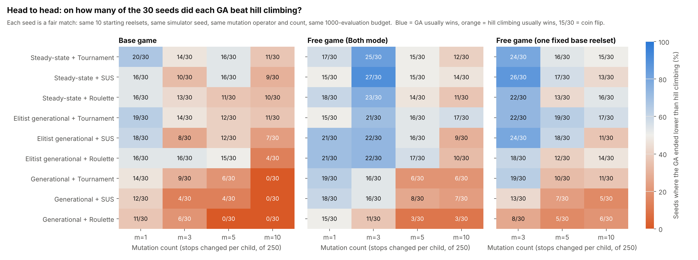

Chart 9 shows the best GA next to the three comparison methods over a whole run; chart 16 counts,
for every GA variant and mutation count, the seeds on which it ended lower than hill climbing.
In the base game the best GA variants win **about half** of these matches (Steady-state +
Tournament 20/30 at m=1, 16/30 at m=5); none wins significantly. The colours also show the
other side of the result: **badly configured GAs lose clearly**. Hill climbing and simulated annealing are
significantly better than **all three Generational** variants at mutation 5 and 10 (two of them
at mutation 3), and than three Steady-state/Elitist variants at mutation 10.

### 6.3 Free game

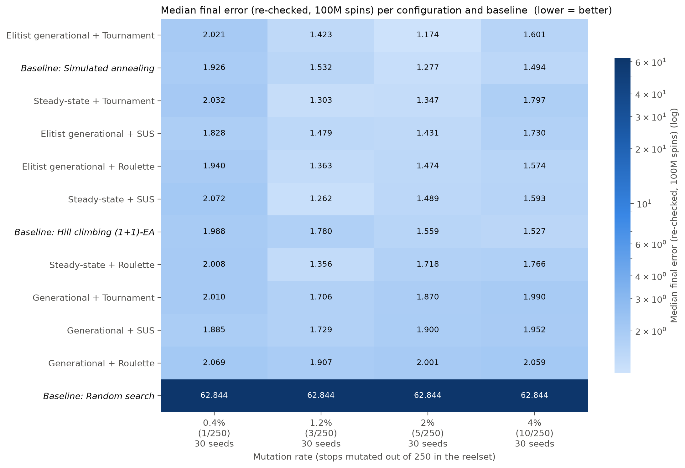

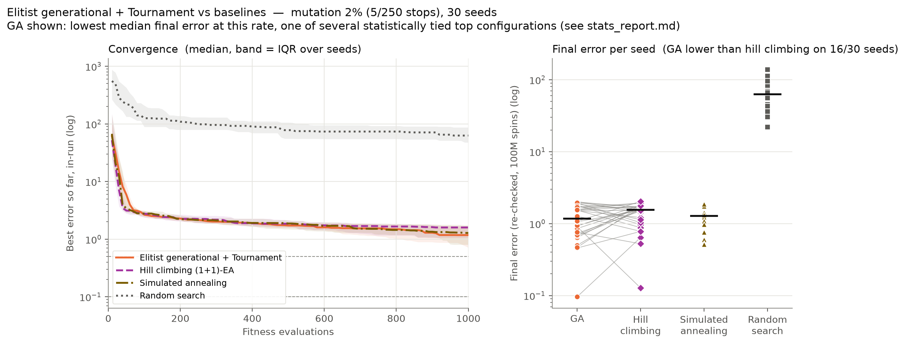

The ranking repeats: Elitist and Steady-state at the top, level with simulated annealing;
plain Generational at the bottom (significantly worse than both other strategies at mutation
3, 5 and 10, A12 0.80–0.94). Differences from the base game:

- **Mutation 1 is worst for 10 of the 11 methods** (medians 1.8–2.1); mutation 3–5 is best.
- **Elitist is better than Steady-state** at mutation 1 and 5 (p = 0.030 and 0.009, medium
  effect); they tie at 3 and 10.
- **The GA beats hill climbing at mutation 3**: all six Steady-state and Elitist variants are
  significantly better (e.g. Steady-state + SUS 1.26 vs 1.78, 27/30 seeds, A12 = 0.83). Hill
  climbing accepts only equal-or-better children, so it probably gets stuck more often on these
  conflicting targets. **Simulated annealing**, which can accept a worse step, does not show that
  weakness: no GA variant is significantly better than it at any mutation count, and it is not
  significantly better than any Steady-state or Elitist variant either.

#### Why the free-game errors stay high

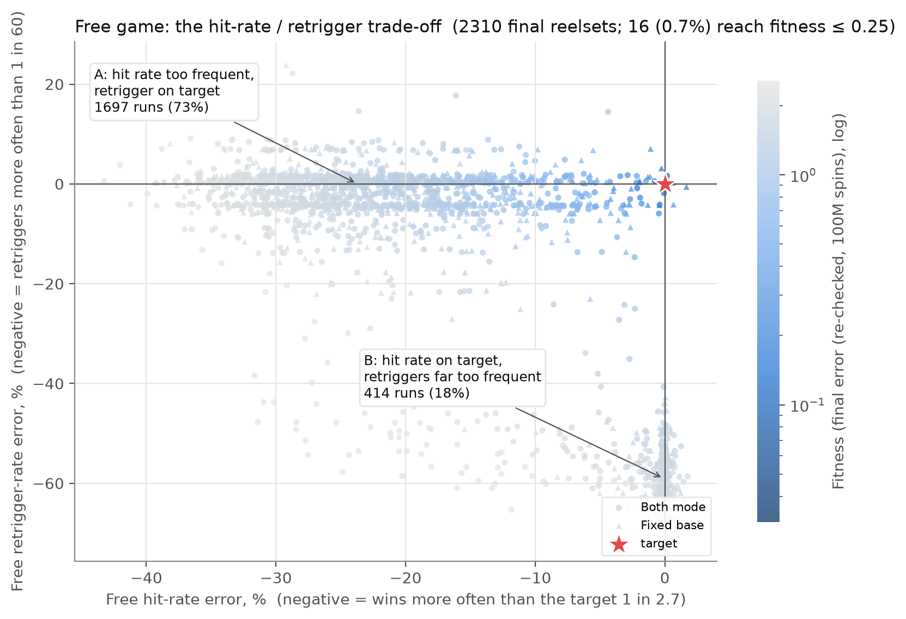

The best free-game medians are about 1.2–1.3, against about 0.1 in the base game. Chart 14 shows
why: across 2,310 final reelsets, 73% hit the retrigger target but win **too often**, and 18% hit
the win-frequency target but retrigger **far too often**; only 16 (0.7%) reach an error of 0.25
or less. Reels that make free spins win less often also make retriggers more common. With this
game's symbols and rules, **the three free-game targets appear to conflict**, so every
optimizer has to trade one against the other. This is a property of the targets, not a
failure of a particular method — and it is the main reason the free-game numbers are
higher.

#### Does the choice of base reels change the free-game result?

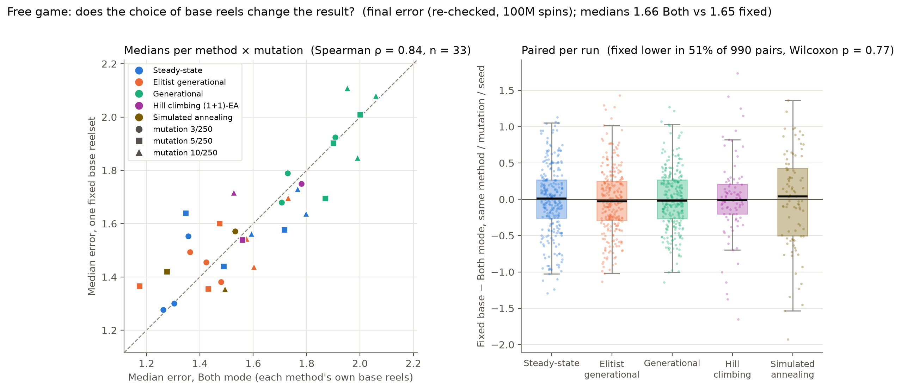

No. With one fixed base reelset for every method, the medians barely move (1.66 Both vs 1.65
fixed overall; fixed is lower in 51% of 990 paired runs; Wilcoxon p = 0.77), and the ranking
of methods is preserved (Spearman ρ = 0.84). The fixed-base check confirms the main findings:
Generational worst everywhere, Steady-state and Elitist tied, Tournament better than Roulette
inside Generational, and the GA significantly better than hill climbing only at mutation 3.

### 6.4 How much does simulator noise matter?

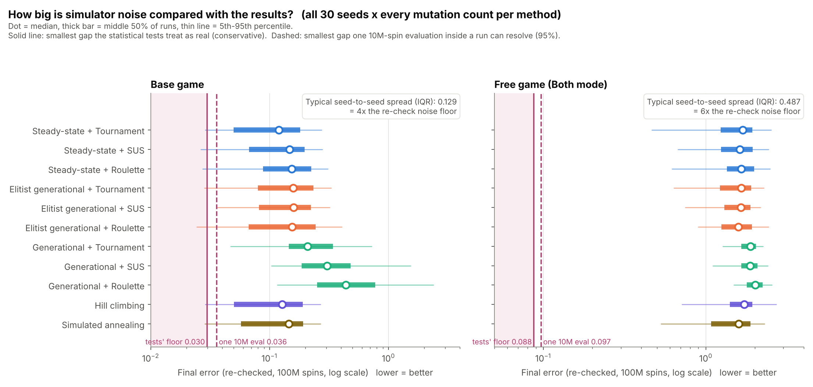

**Size of the noise.** Re-simulating the same reelset 30 times with 10M spins, the fitness
wobbles by (standard deviation, median over reelsets):

| Stage | SD of one 10M-spin score | Range over the 44 GA/baseline reelsets | Smallest real gap in the tests (100M re-check) |
|---|---|---|---|
| Base game | **0.013** | 0.007 – 0.025 | 0.030 |
| Free game | **0.035** | 0.019 – 0.061 | 0.088 |

The underlying statistics are measured very precisely: base RTP ±0.0009, hit rate ±0.0013,
trigger rate ±0.22 (on targets of 0.57, 3 and 80).

**Noise per configuration.** The noise is almost the same for every method, because it comes
from the simulator, not the optimizer (median SD of fitness at 10M spins):

| Configuration | Base SD | Free SD | | Configuration | Base SD | Free SD |
|---|---|---|---|---|---|---|
| Steady-state + Tournament | 0.012 | 0.036 | | Generational + Tournament | 0.014 | 0.038 |
| Steady-state + SUS | 0.014 | 0.032 | | Generational + SUS | 0.018 | 0.032 |
| Steady-state + Roulette | 0.014 | 0.031 | | Generational + Roulette | 0.014 | 0.029 |
| Elitist + Tournament | 0.013 | 0.039 | | Hill climbing | 0.012 | 0.038 |
| Elitist + SUS | 0.012 | 0.043 | | Simulated annealing | 0.011 | 0.035 |
| Elitist + Roulette | 0.013 | 0.040 | | Random search | 0.030 | 0.093 |

**Was noise a deciding factor?** Mostly not:

- **Seed-to-seed differences dwarf simulator noise.** How lucky a run's search is (its starting
  population and random choices) spreads final errors 4× (base) to 6× (free) wider than the
  noise floor (chart 15). The outcome of a run is decided by the search, not by measurement error.
- **The large effects are far above noise.** Generational vs the rest (0.2–0.75 vs ~0.13) and
  random search vs everything are many noise floors apart.
- **At the very top of the base game, noise is the limit.** The best base reelsets have errors
  around 0.03, only two to three times their own noise, and neighbouring reelsets at the top of
  the noise study's ranking have overlapping 95% intervals. Differences of a few hundredths between the best
  methods should not be read as real — which is exactly what the "tied" verdicts reflect.
- **In-run scores are optimistic.** The best in-run score is the luckiest of many noisy
  measurements; on re-check the base-game medians rose by about 4% (up to 63% for
  Steady-state + Tournament at m=1, which reported 0.047 in-run and 0.076 on re-check). In the
  free game the change was between −2% and +7%. This is why every reported result uses the re-check.
- **A shared simulator seed did not reduce noise.** Comparing two reelsets on the same seed
  ("common random numbers") gave the same noise as independent seeds (ratio ≈ 1.0), because
  different reel strips turn the same random stops into different symbols.

### 6.5 Statistical summary

| Question | Base game | Free game (Both) | Free game (fixed base) |
|---|---|---|---|
| Do replacement strategies differ? (Friedman, m=3/5/10) | yes, p < 0.001, W 0.24–0.79 | yes, p < 0.001, W 0.40–0.58 | yes, p < 0.001, W 0.40–0.57 |
| Generational worse than the other two? | yes, every m ≥ 3 (and vs Steady-state at m=1) | yes, every m ≥ 3 | yes, every m |
| Steady-state vs Elitist | tied except m=10 (Steady-state better) | Elitist better at m=1, 5; tied at 3, 10 | tied |
| Selection matters within Steady-state / Elitist? | no | no (one pair at m=1) | no |
| Tournament > Roulette within Generational? | yes, every m | at m=5 | yes, every m |
| GA significantly better than hill climbing? | never | 6 variants at m=3 | 3 variants at m=3 |
| GA significantly better than simulated annealing? | never | never | never |
| Baseline significantly better than GA? | 20 comparisons (16 vs Generational, 4 at m=10) | 14 (all vs Generational) | 12 (all vs Generational) |
| Everything better than random search? | yes, 30/30 seeds, A12 = 1.00 | yes | — |

Full tables, every p-value and effect size: `Results/stats/*/stats_report.md` and
`mutation_report.md`.

### 6.6 Computing cost

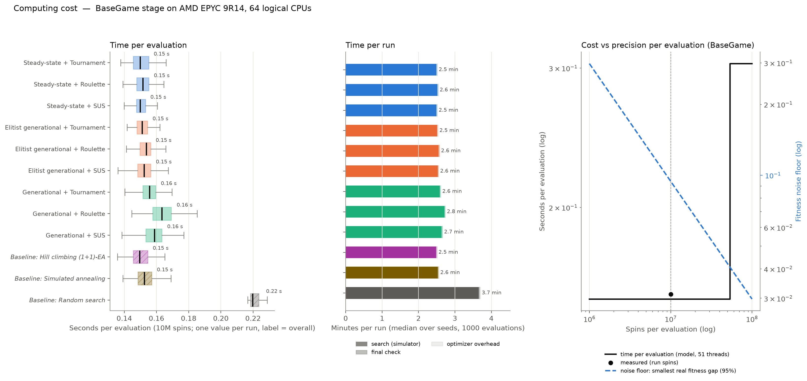

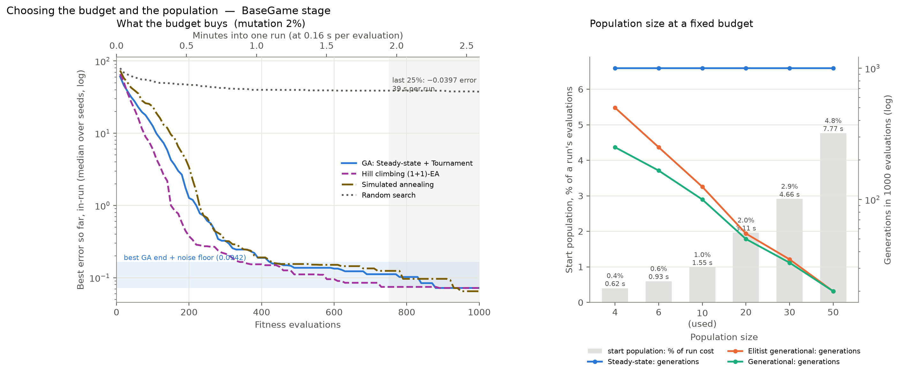

| | |
|---|---|
| One evaluation (10M base spins, 10 threads) | **0.155 s** (≈ 66 million spins per second) |
| One run (1000 evaluations + final check) | ≈ 2.5 minutes |
| Base stage of one seed (45 runs) | ≈ 2 hours |
| Whole main study (both stages, 30 seeds) | 2.7 million simulator calls, 83 h wall time, 798 CPU-hours |

Every GA and local-search method costs about the same per evaluation (0.150–0.165 s), so the equal-evaluation budget is
also an equal-time budget. In the last quarter of the budget the best methods improved by less
than one noise floor, so a longer budget would mostly re-measure noise. (The cost-vs-spins panel
of chart 10 uses a thread model that does not match these runs; see RUNNING.md.)

---

## 7. Conclusions

### Answers to the four questions

**Q1 — Can reel strips be tuned automatically? Yes.** From random reels with a median error of
about 80, every sensible method reached the three base-game targets to within a few percent in
1000 simulations (≈ 2.5 minutes of computing). Random search with the same budget stayed at 37.5,
so the result comes from the search strategy, not from luck or from an easy problem.

**Q2 — Which GA settings matter?** In order of importance:

1. **Replacement strategy.** Plain Generational replacement is significantly worse in both stages,
   at almost every mutation count and in the fixed-base check, because it discards its best
   reelset every generation. Steady-state and Elitist generational, which always keep the best,
   are statistically tied in most settings.
2. **Mutation strength.** 3–5 changed positions out of 250 (about one symbol per reel) is best.
   Ten is significantly harmful for 9 of 11 methods; one is too slow in the free game.
3. **Selection method** hardly matters: Tournament, Roulette and SUS are indistinguishable
   inside Steady-state and Elitist. Tournament helps only when replacement is weak.

**Q3 — Is a GA better than local search? No — it is a draw.** We set out to show that a GA is
a good tool for this problem, and added hill climbing and simulated annealing to test that claim
fairly. Under identical conditions the best GA and simulated annealing end level in every
experiment (base game 0.076 vs 0.075; each lower on about half the seeds; no significant
difference anywhere). The GA beats plain hill climbing only in the free game at one mutation
setting. The likely reason is the structure of the problem: a good reel strip is mostly about
*how many* of each symbol a reel has and roughly *where*, and small one-symbol changes reach it
efficiently; mixing two parent strips (crossover), the GA's distinctive operator, adds little
here.

**Q4 — Does simulator noise distort the answers? Not the conclusions.** Noise was measured
directly (30 repeat simulations of 96 reelsets). It is 4–6 times smaller than the differences
between independent runs of the same method, and the significant differences above are many
noise floors wide. Noise does limit the order among the very best methods, which is why they
are reported as tied rather than ranked. Re-checking every winner with 10× more spins is
necessary, because the best score inside a run is optimistically biased.

### The overall conclusion

**Both families are good enough for automatic reel tuning, provided they are configured
properly.** The choice of settings matters far more than the choice between a GA and local
search: a well-set GA and a well-set simulated annealing are interchangeable, while a badly set
GA (Generational replacement, heavy mutation) is clearly worse than either.

| | Proper settings (supported by this experiment) | Settings to avoid |
|---|---|---|
| **Genetic algorithm** | Steady-state or Elitist generational replacement; any selection (Tournament is the safe default); 3–5 of 250 positions mutated per child; population 10 | Plain Generational replacement; 10+ positions mutated per child |
| **Simulated annealing** | 3–5 positions mutated per step; temperature 0.14 → 0.002 on the log-fitness scale | 1 position per step (too slow) |
| **Hill climbing** | 3–5 positions per step; fine for the base game | Conflicting targets (free game), where it did significantly worse than SA-level methods at mutation 3 |
| **Every method** | Re-check the final reelset with ≥ 100M spins; run several seeds and keep the best | Trusting the in-run best score; trusting one run |

**Practical recommendation for a slot mathematician.** Simulated annealing is the simplest
choice that performed at the top in every experiment: it has one reelset, two temperature
settings and the mutation count. A Steady-state or Elitist GA is an equally good choice and is
the natural starting point for extensions that need a population (for example, showing several
different good reel designs, or multi-objective search). Whichever is used, running it on several
seeds matters more than the choice of method: the spread between seeds is much larger than the
differences between good methods.

### What these results do not show

- They do **not** show that simulated annealing is better than a GA, or the reverse; the
  well-configured methods are statistically tied.
- They do **not** show that GAs are weak in general; the result is for this problem, this game
  and a budget of 1000 simulations.
- They do **not** show that the free-game targets are unreachable for every possible method;
  they show that no method here reached them and that the targets pull against each other.
- Both families were run with **sensible defaults, not tuned to their limit** (section 8); the
  conclusion is "tied under comparable default settings".

### Beyond slots

The setup — a design made of discrete pieces, judged only by noisy simulation, balancing several
weighted targets — also fits paytables and prize tables, game-economy and loot-drop balancing,
timetabling, and simulation-driven engineering design. The lessons carry over: protect the best
solution, mutate gently, measure the noise, and always compare a sophisticated method with a
well-configured simple one under identical conditions.

---

## 8. Limitations and what could be improved

**Limits of this study**

- **One game, one set of targets.** The conclusions are for one 5×3, 20-line game. Other games
  (ways-to-win, cascades, bigger reels) may favour different methods.
- **One budget (1000 evaluations).** A larger budget could favour Elitist's more diverse
  population over Steady-state and hill climbing, which converge and stall.
- **Best mutation count chosen on the same seeds it is reported on**, which slightly flatters
  every method (equally).
- **Neither family was tuned to its limit.** The GA's population size (10) and the annealing
  temperatures (0.14 → 0.002) were fixed in advance. A fuller tuning of both could separate them,
  in either direction.
- **Free-game targets conflict**, so the free-game study compares methods on how well they
  compromise, not on whether they reach the target.
- **Base and free reels tuned separately**, not jointly.
- **Six or more scatters pay no scatter prize** (see the game rule note in section 3). This is
  rare on tuned reels and identical for every method, but a game with a different rule (for
  example, paying the 5-scatter prize, or spacing scatters so 6+ cannot appear) would need its
  own run.

**What could be improved next**

- **Multi-objective search** (e.g. NSGA-II) for the free game: show the designer the whole
  trade-off between hit rate and retrigger rate instead of a single weighted compromise, and
  check whether the targets are reachable at all.
- **Better mutation:** start strong and reduce it over time, or let it adapt to progress; add
  mutations that swap or move symbols instead of replacing them (keeping symbol counts fixed).
- **Diversity protection** for Steady-state (e.g. a child replaces the reelset most similar to
  it, or fresh random reelsets are injected when progress stalls).
- **Hybrids:** GA for exploration, then simulated annealing to finish — combining the two
  families that tied here.
- **Tune both families properly** (population size, annealing schedule, restarts) with an
  automatic tuner, then repeat the comparison on fresh seeds.
- **Cheaper evaluations:** fewer spins early in a run and more near the end, or a surrogate
  model that predicts statistics from symbol counts and only simulates promising reelsets.
- **Better variance reduction:** common random numbers did not help; antithetic spins or
  stratified stop positions might.
- **Wider sensitivity studies:** population size (6/10/20), budget (500/1000/2000), hold-out seeds
  for choosing the mutation count, and more games.
- **Tune both reel sets together**, with total RTP as an explicit goal.
- **Engineering:** release simulator binaries for macOS, add automated tests for the simulator's
  statistics, and fix the thread model in the cost chart.

---

## 9. Glossary

| Term | Meaning |
|---|---|
| **Reel strip / reelset** | The fixed list of symbols on each reel; a reelset is all 5 reels (here for base game and free game). |
| **RTP** (return to player) | Average share of the bet paid back as wins over a very long time. 0.57 = 57%. |
| **Hit rate** | How often a spin wins anything, written as "1 in X spins". |
| **Trigger / retrigger rate** | How often the bonus round starts / how often a bonus spin gives more bonus spins, "1 in X". |
| **Fitness / error** | The weighted sum of relative distances from the targets. 0 is perfect; lower is better. |
| **Evaluation** | One simulation of one reelset (here 10M spins). The budget counts these. |
| **Seed** | The number that fixes all randomness of a run. Same seed = same starting reelsets and same result. |
| **Genetic algorithm (GA)** | A search that keeps a population of solutions and breeds better ones (selection, crossover, mutation, replacement). |
| **Selection / crossover / mutation / replacement** | Picking parents / mixing two parents / randomly changing a few positions / deciding which solutions stay. |
| **Hill climbing, simulated annealing** | Simple searches that improve one solution step by step; annealing sometimes accepts a worse step to escape dead ends. |
| **Noise / noise floor** | Random variation from simulating a finite number of spins / the smallest difference that can be told apart from that variation. |
| **Median, IQR** | The middle value of the 30 seeds / the range holding the middle half of them. |
| **p-value, Holm correction** | Chance of a difference this large if the methods were truly equal / an adjustment so that running many tests does not create false findings. |
| **A12 effect size** | Probability that one method ends lower than another on a run; 0.5 = no difference, ≥ 0.71 = large. |